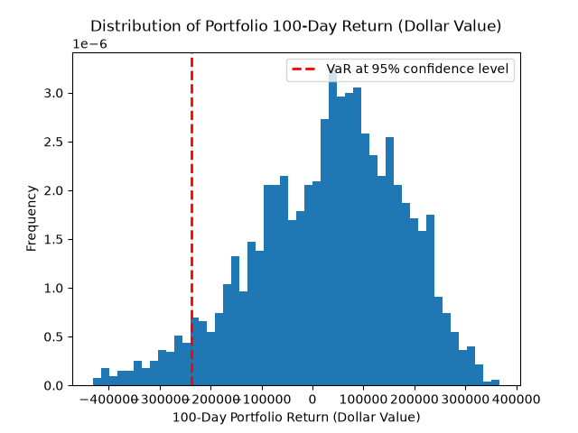
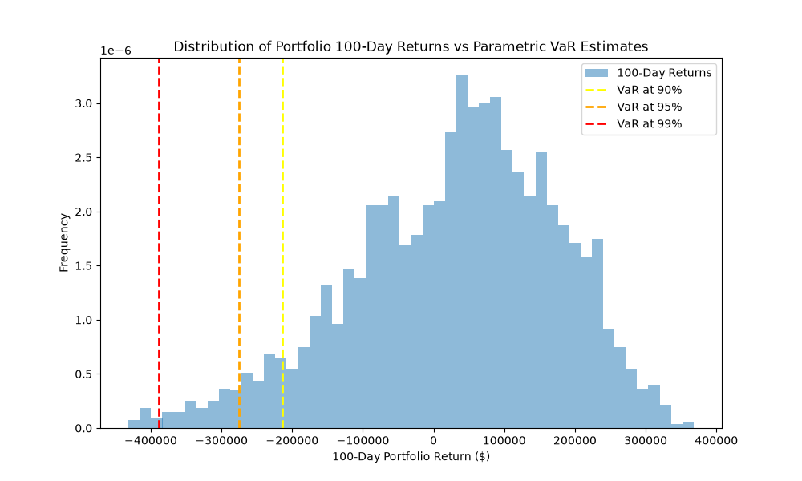
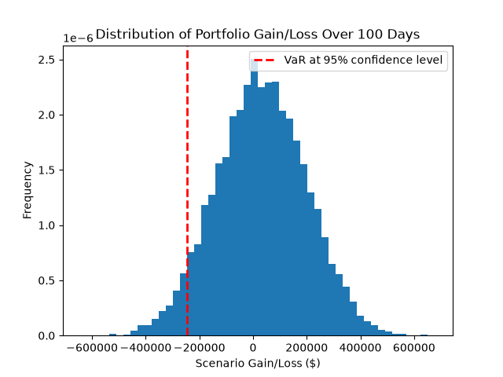

# Portfolio Value at Risk (VaR)

A Python project comparing three approaches to estimating portfolio downside risk:

- **Historical simulation**
- **Parametric (variance–covariance) VaR**
- **Monte Carlo simulation**

The project downloads adjusted historical prices from Yahoo Finance, calculates portfolio returns, and visualizes potential profit and loss over a selected horizon.

## What Is VaR?

Value at Risk estimates a loss threshold for a given confidence level and time horizon.

For example, a **95% 100-day VaR of €100,000** means the model estimates a 5% probability of losing more than €100,000 over that horizon.

VaR is **not the maximum possible loss** and does not describe how severe losses beyond the threshold could be.

## Portfolio

The default portfolio allocates 25% to each of four EUR-denominated European bank listings:

| Ticker | Company | Weight |
|---|---|---:|
| `DBK.DE` | Deutsche Bank | 25% |
| `CBK.DE` | Commerzbank | 25% |
| `SAN.MC` | Banco Santander | 25% |
| `BNP.PA` | BNP Paribas | 25% |

Although the portfolio contains multiple companies, it is concentrated in the banking sector.

### Default Settings

| Parameter | Value |
|---|---|
| Initial portfolio value | €1,000,000 |
| Historical lookback | Approximately 15 years |
| Risk horizon | 100 trading observations |
| Historical / Monte Carlo confidence | 95% |
| Parametric confidence levels | 90%, 95%, 99% |
| Monte Carlo scenarios | 10,000 |
| Monte Carlo random seed | 42 |

These settings can be edited near the top of each script.

## Methods

### 1. Historical VaR

**File:** `VaR_Project_Historical.py`

Calculates daily simple asset returns and combines them using equal portfolio weights. It then compounds daily portfolio returns over rolling 100-observation windows.

Historical VaR is the negative of the lower-tail percentile of the resulting monetary profit-and-loss distribution.

**Assumptions and limitations:**

- The portfolio is rebalanced to equal weights daily, without transaction costs.
- Historical observations represent possible future outcomes.
- Rolling windows overlap, so scenarios are not independent.
- The method cannot directly capture events absent from the historical sample.

### 2. Parametric VaR

**File:** `VaR_Project_Parametric.py`

Estimates portfolio volatility from the covariance matrix of daily simple asset returns and calculates VaR analytically.

With zero expected return:

```text
VaR = Portfolio Value × Daily Portfolio Volatility × √Horizon × Z-Score
```

The script annualizes volatility and then scales it to the selected horizon, which is equivalent to the daily-volatility formula above.

**Assumptions and limitations:**

- Returns follow a normal-distribution approximation.
- Expected return is set to zero.
- Variance is constant and daily returns have no serial correlation.
- Square-root-of-time scaling and linear monetary returns are approximations, especially over a 100-day horizon.
- The model may underestimate risk when returns have heavy tails or volatility changes.

### 3. Monte Carlo VaR

**File:** `VaR_Project_MonteCarlo.py`

Generates 10,000 terminal portfolio profit-and-loss scenarios using normally distributed random shocks and historical portfolio volatility.

It uses the same zero-mean, linear normal model as the parametric method. It does **not** simulate compounded daily asset-price paths.

The script also reports analytical VaR under the same assumptions. The simulated estimate should approach that benchmark as the number of scenarios increases, subject to sampling variation.

A fixed random seed makes the simulation reproducible when the input data and software environment are unchanged.

## How the Methods Compare

| Method | Source of scenarios | Main distinction |
|---|---|---|
| Historical | Observed compounded portfolio returns | Uses the empirical historical distribution |
| Parametric | Analytical normal model | Calculates a threshold directly |
| Monte Carlo | Random draws from the normal model | Estimates the threshold through simulation |

Parametric and Monte Carlo VaR should be close when calculated using identical data and settings.

Historical VaR may differ because it uses observed compounded returns rather than the linear normal approximation.

## Installation

Install Python and the required packages:

```bash
python -m pip install numpy pandas yfinance matplotlib scipy
```

Clone the repository:

```bash
git clone https://github.com/Leo010407/Value-at-Risk.git
cd Value-at-Risk
```

An internet connection is required to download market data.

## Usage

Run each method separately:

```bash
python VaR_Project_Historical.py
```

```bash
python VaR_Project_Parametric.py
```

```bash
python VaR_Project_MonteCarlo.py
```

Each script prints its VaR estimates and opens a Matplotlib chart.

The charts show portfolio profit and loss in EUR. Dashed threshold lines appear on the loss side of the distribution, at negative VaR.

## Data Handling

- **Source:** Yahoo Finance through `yfinance`.
- **Prices:** Adjusted closing prices requested with `auto_adjust=True`.
- **Returns:** Daily simple returns.
- **Validation:** Checks for empty downloads, missing asset data, non-positive prices, insufficient observations, and non-finite returns.
- **Missing observations:** Rows containing missing returns are dropped without filling prices.

Dropping missing observations means a rolling window of 100 retained returns may not correspond to 100 consecutive trading days. Data gaps should be inspected before interpreting results.

Each script downloads data independently. For a controlled comparison, use the same date range, portfolio settings, and underlying data across all three methods.

## Visualizations

Example images stored in the repository:

### Historical VaR



### Parametric VaR



### Monte Carlo VaR



Saved images are illustrative and may reflect earlier settings. Running the scripts generates charts using the current configuration and downloaded data.

## Scope and Limitations

This is an educational risk-modeling project.

- Historical distributions and charts are not out-of-sample backtests.
- Results depend on the selected lookback period and data quality.
- Transaction costs, liquidity constraints, and market impact are excluded.
- The normal models do not explicitly capture changing volatility or extreme market events.
- VaR alone does not measure the severity of losses beyond its threshold.

## Planned Improvements

- Add Expected Shortfall to describe losses beyond VaR.
- Implement one-day out-of-sample backtesting.
- Share one configuration and data-loading module across methods.
- Cache input data for reproducible comparisons.
- Add tests using synthetic data and analytical benchmarks.
- Compare results across different lookback periods and horizons.

## Acknowledgments

The foundational concepts and initial implementation were inspired by the educational quantitative finance materials of **Ryan O’Connell, CFA, FRM**.

This project extends that foundation through comparison of modeling assumptions, return calculations, and data validation.
